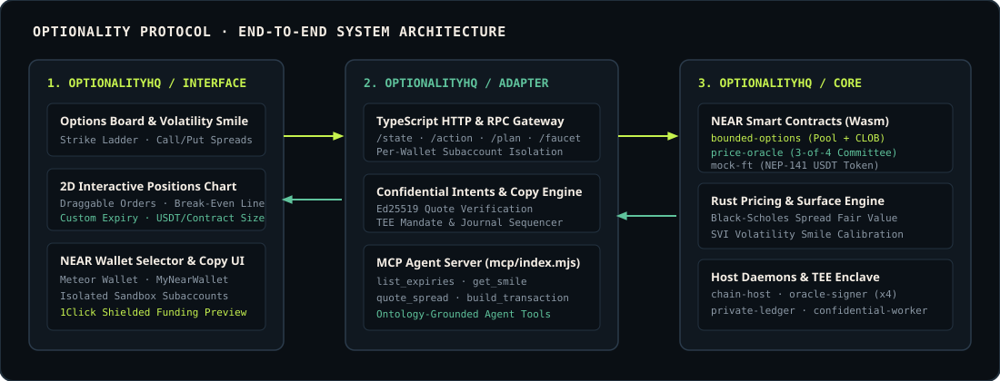
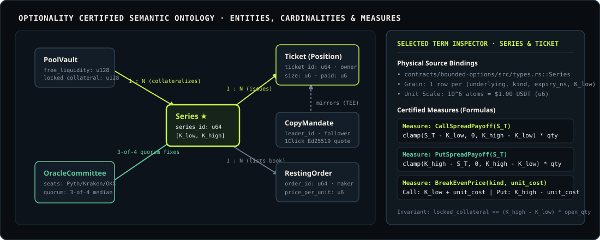
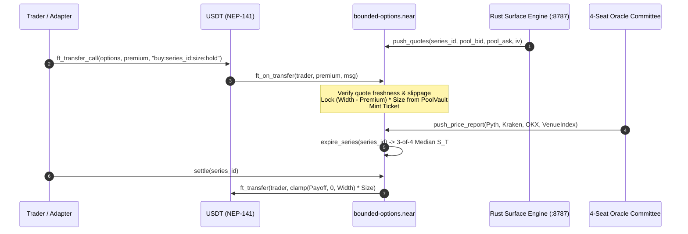

<div align="center">


<br />

[](https://github.com/OptionalityHQ/core)
[](https://github.com/OptionalityHQ/core)
[](https://github.com/OptionalityHQ/core)
[](./Cargo.toml)
[](https://optionality.pro)

**Core Smart Contracts, Rust Volatility Surface Engine, Confidential TEE Ledger & Oracle Daemons for Optionality**

[Live Terminal](https://optionality.pro) · [Protocol Docs](https://optionality.pro/docs) · [Semantic Ontology](./docs/ONTOLOGY.md) · [Interface Repo](https://github.com/OptionalityHQ/interface) · [Adapter Repo](https://github.com/OptionalityHQ/adapter)

</div>

---

## Overview

In 1865, Chicago grain merchants created standardized contracts so a farmer could lock in a floor price for wheat before the harvest — paying a known upfront fee so a price crash could never wipe out the farm. Today's crypto derivatives markets replaced that protection with leveraged perpetuals that liquidate the buyer on a temporary wick, or naked options whose writers can go insolvent when volatility spikes.

**Optionality Core** implements **Bounded Options** on NEAR Protocol: every Call and Put is structured as a **collateral-locked vertical spread** $[K_{\text{low}}, K_{\text{high}}]$. Because the maximum payout per contract is strictly bounded by $W = K_{\text{high}} - K_{\text{low}}$, the smart contract locks **100% of the worst-case payout in NEP-141 USDT** the instant a position opens.

It enables traders, liquidity providers, and autonomous agents to:

- **Eliminate Liquidation & Counterparty Risk** — Buyers can never be liquidated mid-trade (max loss is the upfront USDT premium), and the LP Vault can never go insolvent (100% of $W \times q$ is locked in escrow).
- **Trade Hybrid Pool + CLOB Liquidity** — Take instant quotes from the automated Black-Scholes LP Pool Vault or rest/match limit bids and asks on the on-chain Central Limit Order Book.
- **Settle on an Independent 3-of-4 Oracle Committee** — Four isolated signer processes (**Pyth**, **Kraken**, **OKX**, and **Venue Index**) sign prices with independent Ed25519 keys; settlement requires a 3-of-4 quorum median.
- **Execute Confidential Copy Trading** — Run zero-front-running follower mandates inside the `private-ledger` and `confidential-protocol` crates.

<p align="center">
  
</p>

---

## Software Components

| Crate / Path | Technology | Role | Default Port / Target |
| :--- | :--- | :--- | :--- |
| [`contracts/bounded-options`](./contracts/bounded-options) | Rust, `near-sdk` | Core Bounded Options Pool Vault + CLOB smart contract | `wasm32-unknown-unknown` |
| [`contracts/price-oracle`](./contracts/price-oracle) | Rust, `near-sdk` | 3-of-4 multi-source committee price oracle contract | `wasm32-unknown-unknown` |
| [`contracts/mock-ft`](./contracts/mock-ft) | Rust, `near-sdk` | NEP-141 USDT fungible token contract ($u_6$ decimals) | `wasm32-unknown-unknown` |
| [`core/`](./core) | Rust | Black-Scholes spread pricing, Greeks & margin math | Library crate |
| [`surface/`](./surface) | Rust | Implied volatility smile & SVI surface calibration | Library crate |
| [`engine/`](./engine) | Rust, HTTP | Live pricing & volatility surface server | `127.0.0.1:8787` |
| [`private-ledger/`](./private-ledger) | Rust | Confidential TEE copy-trading ledger & enclave journal | Library crate |
| [`confidential-protocol/`](./confidential-protocol) | Rust | Shielded intent verification & enclave attestation types | Library crate |
| [`tools/chain-host`](./tools/chain-host) | Rust, Tokio | Continuous market-maker quoter, series roller & settler | Background daemon |
| [`tools/oracle-signer`](./tools/oracle-signer) | Rust, Unix Sockets | Isolated per-seat Ed25519 oracle signer daemon | `data/oracle/*.sock` |
| [`tools/oracle-sources`](./tools/oracle-sources) | Rust | Live exchange feed adapters (Pyth, Kraken, OKX, Index) | Library crate |
| [`tools/confidential-worker`](./tools/confidential-worker) | Rust | Confidential enclave execution worker | Background daemon |

---

## How It Works & Protocol Ontology

<p align="center">
  
</p>

Optionality Core is modeled around five source-grounded semantic entities (see [`docs/ONTOLOGY.md`](./docs/ONTOLOGY.md) for the full Question, Relationship, and Measure contracts):

1. **`Series` ($[K_{\text{low}}, K_{\text{high}}, T]$)** — Defines a bounded Call or Put spread on BTC or ETH.
2. **`PoolVault`** — Holds LP capital in two strict buckets: `free_liquidity` (available to underwrite new spreads) and `locked_collateral` (reserved 1:1 for open tickets).
3. **`Ticket`** — An on-chain position receipt recording the holder, contract size $q$, entry cost paid, and whether the holder chose **Liquid** (50 bps fee, can sell early back to the pool or book) or **Hold-to-Expiry** (0 bps fee, pays pure Black-Scholes mid).
4. **`RestingOrder`** — Maker limit bids and collateralized limit asks resting on a series book.
5. **`OracleCommittee`** — Four independent seats submitting signed prints at expiry; the contract sorts valid prints and fixes the median $S_T$.



---

## Repository Structure

```markdown
core/
├── Cargo.toml                  # Rust workspace manifest (14 member crates)
├── contracts/
│   ├── bounded-options/        # Pool Vault + CLOB options contract (lib.rs, math.rs, types.rs)
│   ├── price-oracle/           # 3-of-4 quorum median oracle contract
│   └── mock-ft/                # NEP-141 USDT token contract
├── core/                       # Black-Scholes spread pricing & margin math
├── surface/                    # Volatility smile calibration
├── engine/                     # HTTP pricing & IV surface server (:8787)
├── private-ledger/             # Confidential TEE copy-trading ledger
├── confidential-protocol/      # Shielded execution & attestation protocol
├── tools/
│   ├── chain-host/             # Automated series rolling & market-maker daemon
│   ├── oracle-signer/          # Isolated Ed25519 seat signer process
│   ├── oracle-sources/         # Live Pyth, Kraken, OKX & Venue Index readers
│   └── confidential-worker/    # Enclave batch worker
├── integration-tests/          # Sandbox contract lifecycle & adversarial tests
├── scripts/                    # Build, test, sandbox venue & testnet deployment scripts
└── deploy/                     # Production systemd, Caddy & Docker manifests
```

---

## Quickstart

### 1. Build Contracts & Workspace Crates

```bash
git clone https://github.com/OptionalityHQ/core.git
cd core
bash scripts/build.sh
```

### 2. Run the Unit & Property Test Suite

```bash
cargo test --workspace --exclude bounded-options-integration-tests
```

Expected output:

```text
test result: ok. 280 passed; 0 failed; 0 ignored; 0 measured
```

### 3. Start a Full Local Venue (Sandbox Chain + 4 Oracle Signers + Engine)

```bash
bash scripts/venue.sh start
```

This boots a local NEAR sandbox node, deploys `bounded-options`, `price-oracle`, and `mock-ft`, starts the 4 isolated oracle signer daemons, launches the Rust pricing engine on `http://127.0.0.1:8787`, and writes the session manifest to `data/chain-session.json`.

---

## Deployment Addresses

### NEAR Testnet (`testnet`)

| Contract / Role | Account ID | Description |
| :--- | :--- | :--- |
| **Options Venue** | `options.sable-knee.testnet` | Bounded Options Pool Vault & CLOB Contract |
| **Collateral Token** | `usdt.sable-knee.testnet` | NEP-141 USDT Token ($u_6$ decimals) |
| **Committee Oracle** | `oracle.sable-knee.testnet` | 3-of-4 Multi-Source Price Oracle Contract |
| **Seat 1 (Pyth)** | `pyth.sable-knee.testnet` | Pyth Network Hermes Feed Signer |
| **Seat 2 (Kraken)** | `kraken.sable-knee.testnet` | Kraken Spot Ticker Signer |
| **Seat 3 (OKX)** | `okx.sable-knee.testnet` | OKX Spot Index Signer |
| **Seat 4 (Venue Index)** | `venue-index.sable-knee.testnet` | Composite Venue Index Signer |
